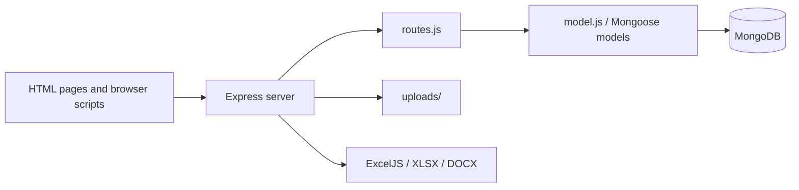

# NCC VVCE Attendance

A Node.js/Express attendance-management application for NCC cadets. It combines HTML/CSS pages with an Express API, MongoDB/Mongoose persistence, password hashing, image uploads, and export helpers for spreadsheet/document reports.

## Architecture



`server.js` configures middleware, static files, uploads, and database startup. `routes.js` contains application endpoints; `model.js` defines persistence structures. Feature pages cover login/registration, cadet management, attendance, refreshment, status, and downloads.

## Setup

```bash
npm ci
# configure the MongoDB connection and session/application settings in your local environment
npm start
# development reload
npm run dev
```

The server requires a reachable MongoDB instance and a writable uploads directory. Do not copy production credentials into `.env` committed to Git.

## Workflow and data

1. A user registers or signs in through the browser pages.
2. Express validates the request and uses bcrypt for password hashing/comparison.
3. Attendance and cadet records are stored through Mongoose.
4. Image evidence is handled with Multer and the generated reports use ExcelJS/XLSX/DOCX.
5. The status and download pages present the resulting records to authorized users.

Important route behavior is implemented in `routes.js`; treat it as the API contract and add versioned endpoint documentation when integrating another client.

## Deployment

Run `npm start` under a process manager or container with Node.js 14+ and MongoDB. Put the service behind HTTPS, configure a persistent volume/object store for uploads, and restrict CORS to the real frontend origin.

## Testing

`npm test` is currently a placeholder that exits with an error. Validate the complete login, attendance, upload, export, and unauthorized-access flows manually or add an API test suite before production use.

## Security and operations

- Keep credentials, database URLs, OAuth tokens, API keys, and signing secrets in environment variables; never commit them.
- Validate and constrain uploaded files and user input at the server boundary, and enable HTTPS in production.
- Review dependency updates and rotate any credential that has appeared in repository history.

## Testing

The repository currently has no comprehensive automated test suite unless noted above. Before production changes, add tests for authentication/authorization, validation failures, persistence errors, and the primary user workflow.

## Limitations and roadmap

This is an actively evolving project. Production hardening, observability, rate limiting, backup/retention policy, and accessibility/performance validation should be completed before handling sensitive or high-volume workloads.

## License

See the repository license file and package metadata for the authoritative terms.
